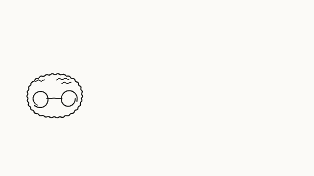
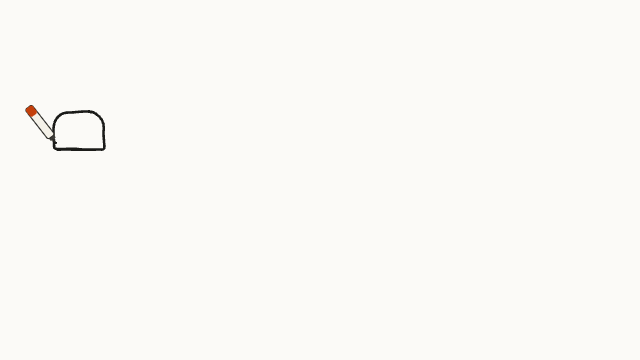
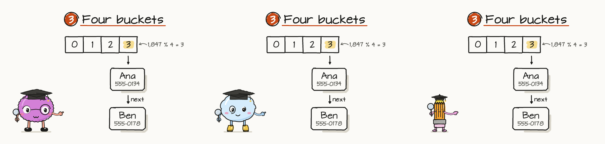

<h1 align="center">Depict</h1>

<p align="center"><b>An Agent Skill that explains a concept by drawing it.</b><br>For Claude Code, and also runs in OpenCode, Codex and Antigravity.<br>A hand-drawn board that builds stroke by stroke, one sentence at a time, presented by an animated guide, and stays explorable when the explanation ends.</p>

<p align="center">
  <a href="https://code.claude.com/docs/en/skills"></a>
  <a href="https://agentskills.io"></a>
  <a href="LICENSE"></a>
  <a href="#requirements"></a>
  <a href="#requirements"></a>
</p>

<p align="center">
  <a href="#quick-start">Quick start</a> ·
  <a href="#what-you-get">What you get</a> ·
  <a href="#gallery">Gallery</a> ·
  <a href="#install">Install</a> ·
  <a href="#examples">Examples</a> ·
  <a href="#how-it-works">How it works</a> ·
  <a href="#checks">Checks</a>
</p>

<p align="center">
  <a href="skills/depict/examples/cpu-cache/cpu-cache.html"></a>
</p>

<p align="center"><sub><code>skills/depict/examples/cpu-cache</code>: the whole one-minute board, from the first stroke to the goodbye. Every letter is written in pen order; the pen follows the tip; the guide is drawn, then performs; the camera flies from idea to idea and ends on the whole board.</sub></p>

## Quick start

```sh
npx skills add destbreso/depict -g -a claude-code
```

Then, in Claude Code:

```text
/depict how a CPU cache works
```

The agent finds the one sentence the idea comes down to, splits it into a few regions, draws the focal thing of each as it really is, writes one sentence per beat and what is drawn while it is said, builds the page, audits it, pictures every beat in a browser, reads the pictures as an artist would and hands you one HTML file. Ask for slides ("as slides"), for a video ("and a video for LinkedIn"), or for a part people can try (a Dissect figure that opens from the board).

As a Claude Code plugin instead: `/plugin marketplace add destbreso/depict`, then `/plugin install depict@depict`, and call it with `/depict:depict`. For OpenCode or Codex, swap the agent: `-a opencode` or `-a codex`.

## What you get

- **A page that plays like a video.** One standalone HTML file, no network. A pen draws each shape and writes each word in the order a hand would, and each sentence is written under the board as it is said, never over the drawing. Pause, scrub, step sentence by sentence, change the speed.
- **A guide with a face, and a cast to choose from.** Every board is presented by a character: depict's own marker by default (a felt marker with its cap in the board's accent), Stuart (a fuzzy pink brain with round glasses, created by Niki, age 7), or one made from any drawing you give it. Each has its own look, its own way of moving (the marker is stiff; Stuart is soft and wobbles like a jelly when he lands) and its own personality (how it arrives and leaves, what it does on its own). It is drawn first, then comes alive its own way, points at each new thing as the pen draws it (only along a clear line: when something is in the way it steps aside to see it, or only looks), never leaves the picture, follows the pen with its eyes, is surprised when something is marked, worried or thinking when the sentence is, hops to the next idea and says goodbye at the end. It is dressed for the subject: a mortarboard and a book, a hard hat and a wrench, glasses and a pointer, headphones, a crown, a ruler, a coin, a clock, Stuart's elf hat and mittens, and his Halloween spider. It blinks and breathes while you explore, and waves back when you tap it.
- **Pitched to its viewer.** It decides from what you ask and what the subject is whether the board is for a young child, a beginner, an adult or an expert, and sets the pace, the words, how concrete the example is and how deep it goes: real blocks and coins and half speed for a seven-year-old, the field's own terms and the internals for a design review.
- **Friends who share a slot.** A board keeps a slot for its guide, so any character drawn to it can present the board instead, cast in as it plays from one file of its own: a round friend or one as narrow as a pencil goes where the board's guide goes and points where it points, and arrives, leaves, gestures and dresses its own way, for the occasion (Halloween, Christmas) or the part (a builder, a chef). [The example](skills/depict/examples/friends/index.html) has Stuart, a rain cloud and a pencil Niki drew present the same board.
- **A character from a drawing.** Give it a drawing (a child's drawing, a sketch; one picture or several of the same character) and it makes it a guide: the drawing's proportions, colors and details kept, the lines evened, every feeling and pose added, a material and a personality chosen, and a model sheet and three test boards to look at before any board uses it.
- **Numbered ideas, read as a page.** Each idea is numbered in the order it is told and the ideas are laid out as a page is read, left to right in balanced rows, so three or ten compose into one 16:9 poster with no empty corner.
- **Explained completely.** The problem and why the obvious way falls short, the mechanism traced step by step on one worked example, why it works, what it costs, the classic mistakes and when to use it.
- **Things drawn as they are.** A chip with its pins, memory sticks, a server rack, bars and curves drawn to scale, colored in with marker fills, framed with drop shadows; people only where people are part of the idea.
- **An ending, not a stop.** After the last sentence the camera pulls back to the whole board, then comes in on the guide saying goodbye its own way (a wave, a bow, a cheer, a salute, a tip of its cap, a spin) as a circle closes on it, and the title is written on the dark.
- **A board that stays.** When the film is over the page goes back to the whole board: zoom it, drag it, and tap any part to go back to the sentence that explained it.
- **Handwriting, not a wipe.** Words are written letter by letter from single-stroke fonts, with a little tilt and drift per letter, in two hands (a clear print and a looser marker), accents and all.
- **A camera that is computed.** Every shot is checked to be readable; the board opens close on the guide and the title, the camera flies between shots along the optimal zoom path, and the board ends on a held overview that reads as a map of the idea.
- **Two modes from one script.** A tour of one big canvas, or sketched slides that end laid out as a numbered storyboard.
- **Live parts.** An item can open into a running [Dissect](https://github.com/destbreso/dissect) figure, grown from its place on the board: the board explains, the figure lets you try.
- **A series.** A course or a set of lessons builds in one go, with one report of what every audit said and a gallery to pick the boards from.
- **A video when you want one.** 1920 x 1080, the board alone and clean, in the form social sites take without trouble, with its sentences as an .srt beside it: subtitles for the site, or the script for a voice.

## Gallery

<table>
  <tr>
    <td width="50%"><a href="skills/depict/examples/cpu-cache/cpu-cache.html"></a></td>
    <td width="50%"><a href="skills/depict/examples/compound-interest/compound-interest.html"></a></td>
  </tr>
  <tr>
    <td><b>How a CPU cache works.</b> A canvas tour: the chip, the cache and the memory drawn as they are, a hit and a miss, why it pays off.</td>
    <td><b>Compound interest.</b> Slides: one idea per numbered sheet, every chart drawn to scale.</td>
  </tr>
  <tr>
    <td width="50%"><a href="skills/depict/examples/ddos/ddos.html"></a></td>
    <td width="50%"><a href="skills/depict/examples/hash-table/hash-table.html"></a></td>
  </tr>
  <tr>
    <td><b>How a site survives a DDoS attack.</b> The last item opens the running Dissect figure of the same system, where every layer has a switch.</td>
    <td><b>How a hash table works.</b> A data structure: someone searching by name, the buckets as adjacent cells, a collision's chain under bucket 3.</td>
  </tr>
</table>

### Characters

<table>
  <tr>
    <td width="50%"><a href="skills/depict/examples/characters/stuart/stuart-test-1.html"></a></td>
    <td width="50%"><a href="skills/depict/examples/characters/marker/marker-test-1.html"></a></td>
  </tr>
  <tr>
    <td><b>Stuart</b>, created by Niki, age 7: a fuzzy pink brain, soft and bouncy, who wobbles like a jelly when he lands and pushes his glasses up before he explains; here as she drew him, as he is, in his winter outfit and with his Halloween spider. <a href="skills/depict/examples/characters/stuart/stuart-sheet.png">His model sheet</a>.</td>
    <td><b>The marker</b>, depict's own guide and the default: a stiff barrel that hops and lands with a firm squash and can tip its cap. <a href="skills/depict/examples/characters/marker/marker-sheet.png">Its model sheet</a>.</td>
  </tr>
</table>

<p align="center"><sub>Each is the presentation <code>scripts/character.mjs</code> writes for a character: its model sheet and three short boards it presents, the same check any character made from a drawing goes through. The GIFs are moments of those boards, made with <code>scripts/gif.mjs</code>.</sub></p>

### Friends who share a slot

<p align="center">
  <a href="skills/depict/examples/friends/index.html"></a>
</p>

<p align="center"><sub>One board, built once, at the same moment: presented by Stuart, by Pip (a rain cloud) and by a pencil Niki drew. Each wears its own mortarboard and points at Ben with its own arm.</sub></p>

A board keeps a slot for its guide: how tall it stands, the paper it takes beside each idea, the room over its head and how far its finger reaches. The board is laid out and its guide directed by that slot, so any character drawn to it can present the board instead, cast in while the board plays. The board is built once and each character is one file, its look: nothing is built again for another guide, and nothing is made for each pair of a board and a character.

- **A body of its own.** A character drawn to Stuart's slot (`contract: "stuart"`) stands as tall as he does and has its own shape, round like Pip or as narrow as the pencil, with its own shoulders, arms and poses. `scripts/look.mjs` checks that it fits the slot and writes its look, 30 to 50 kB.
- **Itself on every board.** It goes where the board's guide goes and points where it points, and it arrives, says goodbye, makes its signature gestures in the quiet moments and moves the way its own material does. Where its own arm could not make one of the board's gestures cleanly, it looks at the thing instead.
- **Dressed by name.** Its own outfits from its drawings (Stuart's winter and Halloween), a part any character can dress for (`builder`, `scholar`, `chef`, `party`, `royal`, `music`, `formal`) or the day's occasion (`"today"`: Halloween, Thanksgiving, Christmas, the Fourth of July and more): a board or a page asks for the name, and each character wears its own. A hat goes on where the board kept room over its guide's head, and a board made to be dressed as it plays keeps room for every one (`guide: { room: "all" }`).

A page casts a character in with one message to the board's frame, and the board answers:

```js
frame.contentWindow.postMessage({ depict: "cast", look, outfit: "today" }, "*");
// heard back: { depict: { event: "cast", ok, character, outfit, wear } }
```

[The example](skills/depict/examples/friends/index.html) is the hash table board with a picker for who presents it and what they dress for, as a site would have one. `references/characters.md`, "Characters that share a slot", has the whole contract.

## Install

Depict is one skill folder, `skills/depict`, with a `SKILL.md` at its root.

| Way | Command | Goes to |
|---|---|---|
| **skills CLI**, for you | `npx skills add destbreso/depict -g -a claude-code` | `~/.claude/skills/depict` |
| **skills CLI**, one project | `npx skills add destbreso/depict -a claude-code` | `.claude/skills/depict` |
| **Claude Code plugin** | `/plugin marketplace add destbreso/depict`, then `/plugin install depict@depict` | managed by Claude Code |

By hand: copy `skills/depict` into `~/.claude/skills/` (Codex: `~/.agents/skills/`, OpenCode: `~/.config/opencode/skills/`, Antigravity: `~/.gemini/antigravity/skills/`).

## Use

Ask in your own words; the skill triggers on explaining, teaching, sketching out or whiteboarding an idea:

```text
/depict the CAP theorem, for my team, under a minute
/depict why the sky is blue, as slides, with a video for LinkedIn
/depict how a hash table works, for someone who just learned arrays
/depict telling time to the nearest five minutes, for my 7-year-old
/depict make a character from my daughter's drawings: drawing-1.jpg drawing-2.jpg
/depict make this pencil my daughter drew a friend of Stuart's, to present his boards: pencil.jpg
```

Open a page in a browser, straight from the file. A preview that reloads the page whenever a file in its folder changes (VS Code's Live Server or Live Preview) stops the film at every reload.

## Examples

| Example | What it shows |
|---|---|
| [`cpu-cache`](skills/depict/examples/cpu-cache/board.mjs) | **How a CPU cache works.** Where data lives, hit or miss, why it pays off: the chip, the cache's lines and the memory sticks drawn as sketches, the memory set far off. A canvas tour in nine beats. |
| [`compound-interest`](skills/depict/examples/compound-interest/board.mjs) | **Compound interest.** Simple against compound interest on $1,000 at 10%, growing bars, the line and the curve over 30 years drawn to scale, the rule of 72. Slides. |
| [`ddos`](skills/depict/examples/ddos/board.mjs) | **How a site survives a DDoS attack.** People and a botnet against a server rack, the layers at the edge as a stack, autoscaling, and a live part that opens Dissect's running figure. |
| [`hash-table`](skills/depict/examples/hash-table/board.mjs) | **How a hash table works.** For someone who just learned arrays: one jump by index, a search by name, a key hashed to an index, buckets as adjacent cells, a collision and its chain, why lookups stay fast. |
| [`friends`](skills/depict/examples/friends/index.html) | **Friends who share a slot.** The hash table board built once, presented by Stuart as a scholar; the looks of Stuart, of Pip (a rain cloud) and of Niki's pencil; and a host page that casts any of them in, dressed for an occasion or a part. |

Rebuild any of them: `node skills/depict/scripts/build.mjs skills/depict/examples/<name>/board.mjs --out <your folder>/<name>.html --audit`.

## How it works

The agent writes a **board script**: the idea's regions, the items in them (a sketch of the thing, a character, or a Lucide icon; a two or three word label; a short note; a frame), the links between items, and the beats, one sentence each with what is drawn or marked while it is said, and how the guide feels. It holds no coordinates.

The kit does the rest, in Node, with nothing but its own modules:

1. **Layout.** Items sit in their region by row (on a ground line), column, grid, radial or cells; the regions are numbered and laid out in reading order, in balanced rows, as many as make the board 16:9; every region gets a frame that holds all of it.
2. **Strokes.** Every shape, sketch, icon and letter becomes polylines in pen order, wobbled by a seeded hand: lines bowed and jittered as Rough.js draws them, ellipses that overshoot where they close, letters from single-stroke fonts; shapes are colored in with a marker's passes and cast grey shadows.
3. **Time.** Each stroke gets its moment: the pen's pace, the lifts between strokes, and each beat at least as long as its sentence takes to read.
4. **Camera.** The board opens close on the guide and the title; each beat is shot from its region's frame; between shots the camera flies along van Wijk and Nuij's path; the board ends on the overview.
5. **The guide.** A character drawn as a rig of components (body, eyes, pupils, brows, mouths, rubber-hose arms, hands, legs, and what it wears and holds), with its own measures, poses, material and personality, and a track written from the timeline: where it stands, where it steps to see what it points at, how it arrives and leaves, its hops, bows, spins and quirks, its gestures, feelings, gaze and blinks. Its pose at any moment follows from its material: a stiff body squashes a little, a soft one squashes deep and sways over its feet.
6. **Page.** All of it goes into one HTML file whose player draws the board and poses the guide as a pure function of time, `render(t)`. Playing, scrubbing and capturing a video frame by frame are the same call.

## Checks

- **The audit**, `--audit` on the build: readable text in every shot, nothing overlapping or outside its slide, captions that fit two lines and read at no more than 20 characters a second, short labels, a quick opening, a closing map, and the composition: a focal point in every region, no empty paper, no crossing lines, no long bridges.
- **The check**, `scripts/check.mjs board.html`: pictures every beat, the overview and the page in headless Chrome and fails on any page error. The agent reads the pictures before handing anything over.
- **A character**, `scripts/character.mjs <character> --out <folder>`: checks a character module, every field, and writes its model sheet (every feeling, pose and costume) and three test boards it presents.
- **A look**, `scripts/look.mjs <character> --out <id>.look.json`: checks that a character drawn to another's slot fits it (at rest within its paper, a costume no higher, hands no bigger), says how far it points beside the slot's own character, and writes the one file a page casts it in from.
- **A series**, `scripts/series.mjs <folder>`: builds, audits and checks every board under `boards/`, keeps one report and writes the gallery.
- **A GIF**, `scripts/gif.mjs board.html@from-to ... --out file.gif`: moments of one or more boards as an animated GIF, for a README or a post that cannot play the page.
- **The video**, `scripts/video.mjs board.html`: 1920 x 1080 at 30 frames a second, H.264 in studio-range color with Rec. 709 tags, a silent audio track and the index first.

`skills/depict/references/craft.md` gives the rules of the genre and where each comes from.

## Requirements

| Needs | For | |
|---|---|---|
| Node.js 20.10+ | everything | built-in modules only |
| Chrome or Chromium | the check and the video | found on its own, or `CHROME_PATH` |
| ffmpeg | the video | |

The page itself needs only a browser.

## What it runs, and what it sends

Everything runs on your machine. The kit uses only Node's built-in modules: nothing is installed, and no account or API key is needed. Building a board writes one HTML file, which makes no network requests when it plays. The check (`scripts/check.mjs`) and the video (`scripts/video.mjs`) start your own Chrome or Chromium in headless mode and drive it through its local DevTools port on 127.0.0.1, and the video runs your own ffmpeg. Depict sends nothing anywhere and collects nothing. The scripts in `tools/` are for maintainers: they rebuild the bundled font and icon files, and the skill never runs them.

## Credits

- The line and ellipse models follow [Rough.js](https://github.com/rough-stuff/rough) (MIT), after Jo Wood's Handy.
- The guide is animated by the principles in Thomas and Johnston's *The Illusion of Life* (squash and stretch, anticipation, arcs, secondary action).
- The handwriting is converted from Evil Mad Scientist's [EMS fonts](https://gitlab.com/oskay/svg-fonts) (SIL Open Font License 1.1): EMS Tech, after Architects Daughter, and EMS Casual Hand, after Covered By Your Grace, both by Kimberly Geswein.
- The icons are [Lucide](https://lucide.dev) (ISC; icons from Feather, MIT).
- The camera's flights are van Wijk and Nuij's "Smooth and efficient zooming and panning" (InfoVis 2003).
- Live parts open figures made with [Dissect](https://github.com/destbreso/dissect).
- Stuart was created by Niki, age 7, who drew him in three pictures. She drew the pencil in the friends example too.

## License

MIT. The fonts and the icons in the kit keep their own licenses, which travel with them (`skills/depict/LICENSE`).
