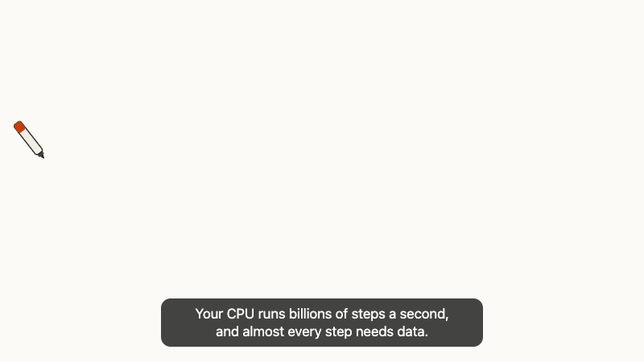
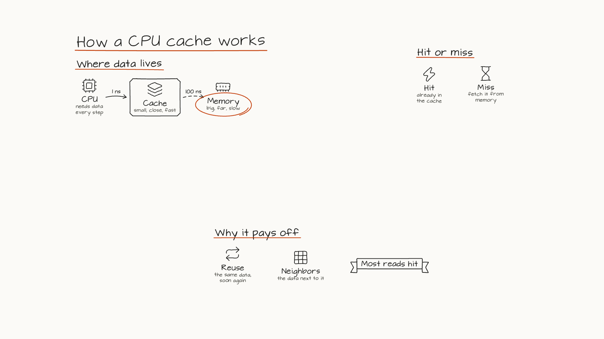
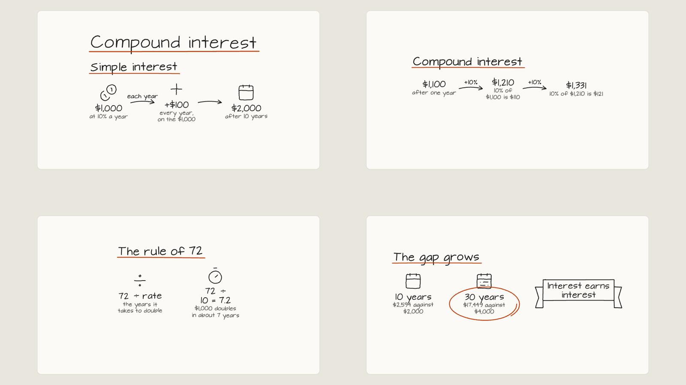
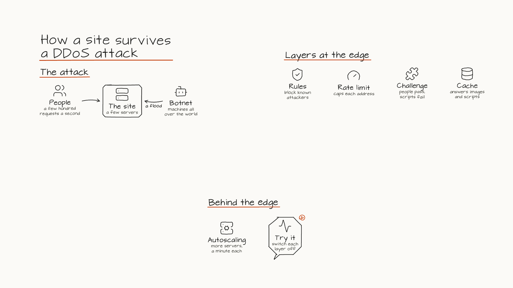
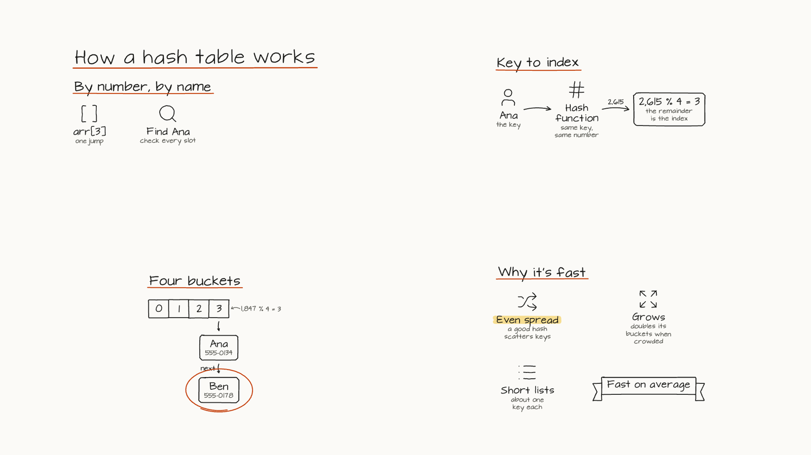

<h1 align="center">Depict</h1>

<p align="center"><b>An Agent Skill that explains a concept by drawing it.</b><br>For Claude Code, and also runs in OpenCode, Codex and Antigravity.<br>A hand-drawn board that builds stroke by stroke, one sentence at a time, and stays explorable when the explanation ends.</p>

<p align="center">
  <a href="https://code.claude.com/docs/en/skills"></a>
  <a href="https://agentskills.io"></a>
  <a href="LICENSE"></a>
  <a href="#requirements"></a>
  <a href="#requirements"></a>
</p>

<p align="center">
  <a href="#quick-start">Quick start</a> ·
  <a href="#what-you-get">What you get</a> ·
  <a href="#gallery">Gallery</a> ·
  <a href="#install">Install</a> ·
  <a href="#examples">Examples</a> ·
  <a href="#how-it-works">How it works</a> ·
  <a href="#checks">Checks</a>
</p>

<p align="center">
  <a href="skills/depict/examples/cpu-cache/cpu-cache.html"></a>
</p>

<p align="center"><sub><code>skills/depict/examples/cpu-cache</code>: the first seventeen seconds of a forty-nine second board. Every letter is written in pen order; the marker follows the tip.</sub></p>

## Quick start

```sh
npx skills add destbreso/depict -g -a claude-code
```

Then, in Claude Code:

```text
/depict how a CPU cache works
```

The agent splits the idea into a few regions, writes one sentence per beat and what is drawn while it is said, builds the page, audits it, pictures every beat in a browser, reads the pictures and hands you one HTML file. Ask for slides ("as slides"), for a video ("and a video for LinkedIn"), or for a part people can try (a Dissect figure that opens from the board).

As a Claude Code plugin instead: `/plugin marketplace add destbreso/depict`, then `/plugin install depict@depict`, and call it with `/depict:depict`. For OpenCode or Codex, swap the agent: `-a opencode` or `-a codex`.

## What you get

- **A page that plays like a video.** One standalone HTML file, no network. A pen draws each shape and writes each word in the order a hand would, and each sentence shows as a caption. Pause, scrub, step sentence by sentence, change the speed.
- **A board that stays.** When the explanation ends the board does not go blank: zoom it, drag it, and tap any part to go back to the sentence that explained it.
- **Handwriting, not a wipe.** Words are written letter by letter from single-stroke fonts, with a little tilt and drift per letter, in two hands (a clear print and a looser marker), accents and all.
- **A camera that is computed.** Every shot is checked to be readable; the camera flies between shots along the optimal zoom path, and the board ends on a held overview that reads as a map of the idea.
- **Two modes from one script.** A tour of one big canvas, or sketched slides that end laid out like a deck.
- **Live parts.** An item can open into a running [Dissect](https://github.com/destbreso/dissect) figure, grown from its place on the board: the board explains, the figure lets you try.
- **A video when you want one.** 1920 x 1080 with the captions burned in, in the form social sites take without trouble.

## Gallery

<table>
  <tr>
    <td width="50%"><a href="skills/depict/examples/cpu-cache/cpu-cache.html"></a></td>
    <td width="50%"><a href="skills/depict/examples/compound-interest/compound-interest.html"></a></td>
  </tr>
  <tr>
    <td><b>How a CPU cache works.</b> A canvas tour in three regions; the board ends on the whole picture.</td>
    <td><b>Compound interest.</b> Slides: one idea per sheet, every number checked.</td>
  </tr>
  <tr>
    <td width="50%"><a href="skills/depict/examples/ddos/ddos.html"></a></td>
    <td width="50%"><a href="skills/depict/examples/hash-table/hash-table.html"></a></td>
  </tr>
  <tr>
    <td><b>How a site survives a DDoS attack.</b> The last item opens the running Dissect figure of the same system, where every layer has a switch.</td>
    <td><b>How a hash table works.</b> A data structure: the buckets are adjacent cells, and a collision's chain hangs under bucket 3.</td>
  </tr>
</table>

## Install

Depict is one skill folder, `skills/depict`, with a `SKILL.md` at its root.

| Way | Command | Goes to |
|---|---|---|
| **skills CLI**, for you | `npx skills add destbreso/depict -g -a claude-code` | `~/.claude/skills/depict` |
| **skills CLI**, one project | `npx skills add destbreso/depict -a claude-code` | `.claude/skills/depict` |
| **Claude Code plugin** | `/plugin marketplace add destbreso/depict`, then `/plugin install depict@depict` | managed by Claude Code |

By hand: copy `skills/depict` into `~/.claude/skills/` (Codex: `~/.agents/skills/`, OpenCode: `~/.config/opencode/skills/`, Antigravity: `~/.gemini/antigravity/skills/`).

## Use

Ask in your own words; the skill triggers on explaining, teaching, sketching out or whiteboarding an idea:

```text
/depict the CAP theorem, for my team, under a minute
/depict why the sky is blue, as slides, with a video for LinkedIn
/depict how a hash table works, for someone who just learned arrays
```

## Examples

| Example | What it shows |
|---|---|
| [`cpu-cache`](skills/depict/examples/cpu-cache/board.mjs) | **How a CPU cache works.** Where data lives, hit or miss, why it pays off. A canvas tour in eight beats. |
| [`compound-interest`](skills/depict/examples/compound-interest/board.mjs) | **Compound interest.** Simple against compound interest on $1,000 at 10%, the gap after 10 and 30 years, the rule of 72. Slides. |
| [`ddos`](skills/depict/examples/ddos/board.mjs) | **How a site survives a DDoS attack.** The attack, the layers at the edge, autoscaling, and a live part that opens Dissect's running figure. |
| [`hash-table`](skills/depict/examples/hash-table/board.mjs) | **How a hash table works.** For someone who just learned arrays: a key hashed to an index, buckets as adjacent cells, a collision and its chain, why lookups stay fast. |

Rebuild any of them: `node skills/depict/scripts/build.mjs skills/depict/examples/<name>/board.mjs --out <your folder>/<name>.html --audit`.

## How it works

The agent writes a **board script**: the idea's regions, the items in them (a Lucide icon, a two or three word label, a short note, a frame), the links between items, and the beats, one sentence each with what is drawn or marked while it is said. It holds no coordinates.

The kit does the rest, in Node, with nothing but its own modules:

1. **Layout.** Items sit in their region by row, column or grid; regions follow a path that wraps so the whole board fits 16:9; every region gets a frame that holds all of it.
2. **Strokes.** Every shape, icon and letter becomes polylines in pen order, wobbled by a seeded hand: lines bowed and jittered as Rough.js draws them, ellipses that overshoot where they close, letters from single-stroke fonts.
3. **Time.** Each stroke gets its moment: the pen's pace, the lifts between strokes, and each beat at least as long as its sentence takes to read.
4. **Camera.** Each beat is shot from its region's frame; between shots the camera flies along van Wijk and Nuij's path; the board ends on the overview.
5. **Page.** All of it goes into one HTML file whose player draws the board as a pure function of time, `render(t)`. Playing, scrubbing and capturing a video frame by frame are the same call.

## Checks

- **The audit**, `--audit` on the build: readable text in every shot, nothing overlapping or outside its slide, captions that fit two lines and read at no more than 20 characters a second, short labels, a quick opening, a closing map.
- **The check**, `scripts/check.mjs board.html`: pictures every beat, the overview and the page in headless Chrome and fails on any page error. The agent reads the pictures before handing anything over.
- **The video**, `scripts/video.mjs board.html`: 1920 x 1080 at 30 frames a second, H.264 in studio-range color with Rec. 709 tags, a silent audio track and the index first.

`skills/depict/references/craft.md` gives the rules of the genre and where each comes from.

## Requirements

| Needs | For | |
|---|---|---|
| Node.js 20.10+ | everything | built-in modules only |
| Chrome or Chromium | the check and the video | found on its own, or `CHROME_PATH` |
| ffmpeg | the video | |

The page itself needs only a browser.

## Credits

- The line and ellipse models follow [Rough.js](https://github.com/rough-stuff/rough) (MIT), after Jo Wood's Handy.
- The handwriting is converted from Evil Mad Scientist's [EMS fonts](https://gitlab.com/oskay/svg-fonts) (SIL Open Font License 1.1): EMS Tech, after Architects Daughter, and EMS Casual Hand, after Covered By Your Grace, both by Kimberly Geswein.
- The icons are [Lucide](https://lucide.dev) (ISC; icons from Feather, MIT).
- The camera's flights are van Wijk and Nuij's "Smooth and efficient zooming and panning" (InfoVis 2003).
- Live parts open figures made with [Dissect](https://github.com/destbreso/dissect).

## License

MIT. The fonts and the icons in the kit keep their own licenses, which travel with them (`skills/depict/LICENSE`).
